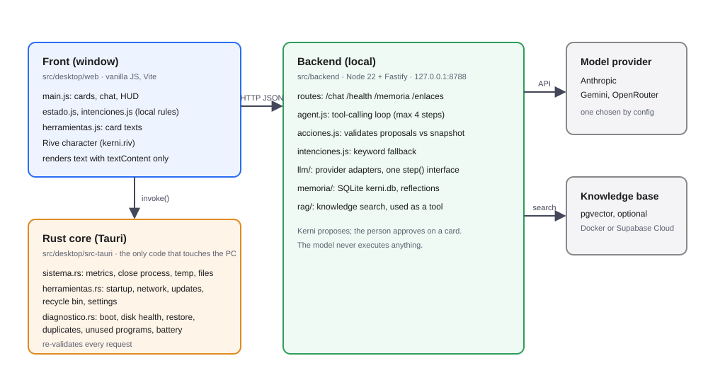

# Kerni architecture

Kerni is a Windows desktop pet (Tauri v2) that reads the PC's health and proposes actions the person approves on a card. The model never executes anything.

## Components

- **Front (`src/desktop/web`)**: draws the character, the bubble, the HUD and the cards. Renders all system and model text with `textContent`. Local rules (`web/intenciones.js`) answer short, deterministic requests without the model.
- **Rust core (`src/desktop/src-tauri`)**: the only code that touches the system. Reads metrics, closes or freezes (and resumes) processes, cleans temp folders and browser caches, lists files, reads startup entries, network, updates, restore points, and runs read-only diagnostics (boot time, disk health, duplicates, unused programs, battery). It re-validates every request before acting.
- **Backend (`src/backend`)**: Node 22 + Fastify on loopback only. Runs the agent loop, validates proposals against the latest system snapshot, keeps local memory, and talks to the model provider.

## One chat turn

1. The front sends `POST /chat` with the message, a system snapshot, the PC model, `device_id` and `session_id`.
2. `chat.js` checks the rate limit, validates the snapshot schema, loads memory and starts a 50 s deadline (the front gives up at 60 s).
3. `agent.js` builds the context (date, memory, PC model, snapshot as data between tags) and runs up to 4 steps with the provider. Tools: `proponer_accion`, `proponer_recuerdo`, `buscar_conocimiento` (max 2 per turn), `revisar_enlace` (max 3 per turn).
4. Each `proponer_accion` call is checked by `acciones.js` against the snapshot (pid, name, start time, closed lists). Invalid proposals go back to the model as errors.
5. If the model fails, lacks quota or the link is down, `intenciones.js` can still propose the obvious action and the guide text is used as the fallback.
6. The response returns `respuesta` plus `acciones`. The front shows each action as a card. Nothing runs until the person clicks **Aprobar**.
7. Approved actions are called in Rust, which checks them again.

## Invariants (do not break)

- **Propose, do not act.** Only the person's click executes an action. Read-only tools still go through a card.
- **Double validation.** Backend validates against the snapshot; Rust validates again before touching the system.
- **Protected processes** live in two lists that must match: `PROCESOS_PROTEGIDOS` (`telemetria.js`) and `PROTEGIDOS` (`sistema.rs`). A test compares them.
- **System data is data.** Names and paths are cleaned (`limpiarNombre`, `sanearParaBloque`) and wrapped in tags the persona is told to treat as data, not instructions.
- **Closed lists.** `abrir_ajuste` destinations and the Windows commands are fixed lists or fixed scripts; text from the person or the model never reaches PowerShell.
- **Memory never breaks chat.** Memory reads and writes are wrapped; a failure is logged and the chat continues.

## Model providers

`llm/proveedores.js` picks one provider: `LLM_PROVIDER` if set, otherwise the first with a key (Anthropic, Gemini, OpenRouter). All providers implement the same `step()` interface, so the agent loop does not know which one is active.

- **Anthropic** (`llm/anthropic.js`): default model `claude-haiku-5-5`. Thinking is disabled and the reply budget is 1024 tokens (Haiku spends the budget on hidden reasoning otherwise). SDK errors are mapped to `llave_invalida`, `sin_cupo` or `sin_red`.
- **Gemini and OpenRouter** (`llm/chatCompletions.js`): OpenAI-compatible endpoints with retries, a per-call timeout, and clear messages for quota and key errors.

When the model is unavailable, `/chat` answers from the guides (RAG) or from the local rules, and says so.

## Memory

- SQLite (`node:sqlite`, experimental in Node 22) at `%APPDATA%/Kerni/kerni.db` (or `KERNI_DATA_DIR`). Keys are per `device_id`.
- Stores: approved facts (`proponer_recuerdo`, with a card), chat turns, health summaries (one per 10 min, 30-day purge), and reflections.
- Reflections are extracted in the background after each turn. They are capped at 200 per device and forgotten ones are tombstoned.
- Known gap: reflections are saved without a card, which conflicts with the "propose, the person decides" rule. Pending owner decision.

## Knowledge base (optional RAG)

- PostgreSQL with pgvector, either locally in Docker (`supabase/local/`) or in Supabase Cloud. Embeddings use `gemini-embedding-001` (768 dimensions).
- `npm run indexar` indexes `conocimiento/` (`.md`, `.txt`, `.pdf`). Manuals are grouped by PC model in `privado/<marca>-<modelo>/`.
- The search is a tool the model calls. It returns text as reference, not instructions.

## Ports and processes

| Process | Address | Notes |
|---|---|---|
| Backend | `127.0.0.1:8788` | Rejects requests whose Host header is not loopback |
| Vite dev server | `localhost:1421` | Only in dev or browser demo |
| WebView2 debug port | `9222` (optional) | Only when started with the debug argument |

## Build and test

- `src/backend`: `npm test` (vitest, no keys needed). `npm run probar-llm` calls the real provider.
- `src/desktop`: `npm test` (node:test, front logic and wiring checks).
- `src/desktop/src-tauri`: `cargo test` (Rust core, Windows scripts, parsers).
- `Kerni.bat` starts the backend and the app; `Kerni-nube.bat` does the same with Supabase Cloud.
- CI (`.github/workflows/`): `build-windows.yml` (manual) builds the installer; `ci.yml` runs the three test suites on push and pull request.

## Known limits

- The backend runs only on the PC. There is no cloud backend or sidecar yet.
- Live Windows behavior of new cards (freeze, browser cache cleanup, restore button) needs manual checks in the real window. The freeze logic is unit-tested; a real process has not been frozen yet.
- Kerni resumes frozen processes when it exits; if it crashes while something is frozen, the process stays frozen until resumed by hand.
- Linux code paths are checked only by their pure helper tests.
- `node:sqlite` requires Node 22.13 or later; `package.json` says `>=22`.
